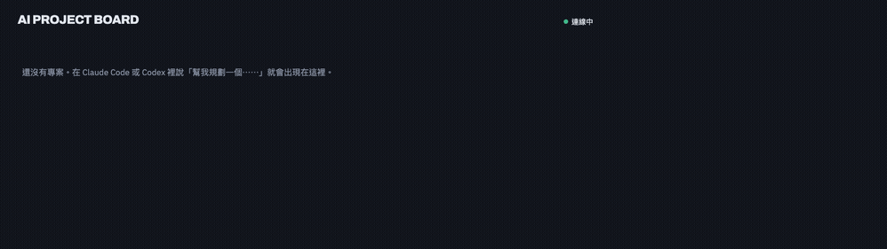

# AI Project Board

> 讓多個 Claude Code 與 Codex agent 不重複領任務、不跳過前置，並用驗證證據回報完成。
> 預設本機執行，也可選用單人雲端部署。

[英文首頁](README.md) ·
[最新版本](https://github.com/hpigu/AIProjectDashboard/releases/latest) ·
[安裝指南](docs/installation.md) ·
[MCP 工具參考](docs/mcp-tools.md) ·
[需求驗收協定](docs/acceptance-protocol.md) ·
[管理授權](docs/authorization-boundaries.md) ·
[備份與還原](docs/backup-recovery.md)



AI coding agent 擅長執行單一任務，但同時開多個 session 後，會出現另一類問題：
誰該做下一件、哪些工作還在等前置，以及任務是否真的驗證完成。

AI Project Board 透過本機 MCP server 管理這個協作流程。Agent 原子認領可執行的
任務、記錄結構化阻塞原因，並在完成時附上測試、變更檔案與 commit 證據。
瀏覽器看板會即時顯示所有專案進度。

若要讓電腦關機後仍能共用看板，可評估獨立的
[Workers＋D1 免費方案部署版本](docs/workers-deployment.md)。它沿用原本零建置前端，
瀏覽器採 Access 登入，Codex／Claude Code 使用各裝置的機器憑證；與本機 H2 資料
分開，雲端資源仍需明確授權後才建立。免費額度與正式客戶端相容性須實際驗收。
[架構與驗證計畫](docs/workers-architecture.md)記錄了移植範圍；原本的
[VM＋Tunnel 方案](docs/cloud-deployment.md)保留作替代選項。
之後的新功能如何同步到雲端、備份與回退，見[雲端更新流程](docs/workers-updates.md)。

## 核心能力

- **避免重複工作**：並行認領使用 compare-and-swap，同一任務只會發給一個 agent。
- **強制任務相依**：前置未完成的任務不會被發放，其他無相依工作仍可繼續。
- **結案閘門**：需求與證據綁定版本，受控執行紀錄、獨立審查及專案 Git policy 共同決定能否結案。
- **跨 session 進度**：Claude Code 與 Codex 可對不同專案與角色共用同一看板。
- **角色不限配額**：跨專案依平台實際 session 上限、任務相依、檔案與資源衝突派工，槽位不足時排隊補派。
- **本機優先**：預設只監聽 `127.0.0.1`，資料存在本機 H2，前端不依賴 CDN。
- **可追溯歷史**：認領、阻塞、狀態變更與完成證據都會顯示在任務詳情。

## 在對話設定專案 Git 流程

對代理說「請為專案『名稱』規劃 Git 流程」。代理先讀文件、只問待決項，整理七欄與修改差異並保存草稿；你用獨立 owner 工具確認後生效。專案頁即使沒有任務也可查看有效設定、版本、核准紀錄與草稿。後續任務沿用，不必重填。詳見[操作與核准方式](docs/project-git-workflow.md)。

## 驗收升級注意事項

所有新完成操作（包含舊任務）都必須透過 `complete_task` 通過驗收閘門；
`update_task_status(..., DONE)` 已取消。既有 DONE 保留歷史狀態，沒有新版驗收紀錄時
仍標示未驗證，不能解鎖新的下游認領。使用前須配置專案範圍與最小權限的獨立簽署身分，並先登錄
PROJECT_POLICY；代理自填 PASSED 無法結案。HMAC 只證明設定授權的簽署身分，
不自動證明內容真實；CI 需要受測程式與開發代理都碰不到金鑰的隔離簽署邊界。
預設沒有啟用任何可信身分。完整流程與相容性見[需求驗收協定](docs/acceptance-protocol.md)。

隔離範例不代表真實公司系統、公司 Git flow 或 Amazon Bedrock 設定已驗證。
修改 repo 內角色指引也不會同步既有線上角色。[備份與還原](docs/backup-recovery.md)
提供隔離還原及可設定的加密離機匯出；本次尚未設定目的地或上傳離機備份。

## 從 source 啟動

需要 JDK 21；不需預先安裝 Maven。第一次啟動會下載依賴並建置 server。

macOS 或 Linux：

```bash
git clone https://github.com/hpigu/AIProjectDashboard.git
cd AIProjectDashboard
./bin/board start
```

Windows PowerShell：

```powershell
git clone https://github.com/hpigu/AIProjectDashboard.git
cd AIProjectDashboard
.\bin\board.ps1 start
```

啟動就緒後開啟 <http://127.0.0.1:8080>。

[`v3.2.1`](https://github.com/hpigu/AIProjectDashboard/releases/tag/v3.2.1)
也提供 Linux x64、macOS arm64／x64 JAR、Windows x64 ZIP 與
`SHA256SUMS.txt`。Windows ZIP 內含 Java runtime；macOS／Linux 需對應架構的
JDK 21。完整流程見 [安裝與更新](docs/installation.md)。

## 連接 Codex

```bash
codex plugin marketplace add hpigu/AIProjectDashboard --ref main
codex plugin add ai-project-board@ai-board
```

依提示啟用 `board` connector，安裝後開新 task，讓角色 agent 與 `claim-tasks`
skill 載入。

既有安裝可直接在 Codex 桌面版的 plugin 頁面更新 `ai-board` marketplace；CLI
替代指令是 `codex plugin marketplace upgrade ai-board`。更新後開新 task，不需
重新安裝 plugin。

## 連接 Claude Code

從本機 clone 加入 marketplace：

```bash
claude plugin marketplace add /path/to/AIProjectDashboard
claude plugin install ai-project-board@ai-board
```

重新載入 plugin 或重開 Claude Code，再依提示安裝 `board` connector。

Claude Desktop 可從 **Code → Customize → Plugins → AI Project Board** 按
**Update**；CLI 替代流程見 [安裝與更新](docs/installation.md)。

## 只連接 MCP

這個方式只提供工具，不包含角色薄殼與 leader skill。

Claude Code：

```bash
claude mcp add --transport http board http://127.0.0.1:8080/mcp --scope project
```

Codex，加入 `~/.codex/config.toml`：

```toml
[mcp_servers.board]
url = "http://127.0.0.1:8080/mcp"
```

## 建立第一個看板

前端是唯讀觀測介面；寫入由 agent 透過 MCP 執行。連線完成後，可以說：

```text
建立一個叫「結帳穩定性」的專案，拆成後端、前端、測試、基礎設施與文件任務，
並把前置關係寫進 AI Project Board。
```

然後在要開發的 repo 中說：

```text
認領「結帳穩定性」的任務，開始可執行的工作。
```

看板會透過 SSE 即時更新，不需重新整理。Leader 可依各專案分類容量派發可執行
任務，再透過 `dev` 整合並於批次完成後安排 reviewer。容量設定與三個 Claude Code
Backend Worker 的範例見[角色與派工](docs/agent-roles.md)。

## 介面

- 專案列表：進度、阻塞狀態、搜尋、篩選與排序。
- 專案看板：Kanban 與任務相依圖。
- 任務篩選：分類、認領者、等待前置、是否可認領。
- 任務詳情：歷史、結構化 blocker 與完成證據。
- BLOCKED 桌面通知：預設關閉，可由標題列啟用。
- 中英文即時切換與 SSE 連線狀態。

## 核心 MCP 工具

| 工具 | 用途 |
|---|---|
| `create_project` | 建立專案 |
| `create_tasks` | 建立 1–50 筆任務並指定前置 |
| `list_tasks` | 查詢專案進度與任務狀態 |
| `claim_next_task` | 原子認領該角色最早可執行的任務 |
| `block_task` | 記錄結構化阻塞原因 |
| `complete_task` | 以摘要與驗證證據完成任務 |

Server 目前有 16 個 MCP 工具，完整參數與狀態規則見
[`docs/mcp-tools.md`](docs/mcp-tools.md)。

## 安全模型

這是單機、可信任使用者產品。

- Server 預設只監聽 `127.0.0.1`。
- `/mcp` **沒有 server-side authentication**，不要直接開放到 LAN 或公開網路。
- Host 與 Origin 檢查用來阻擋 DNS rebinding。
- Worker 工具白名單是 client-side 邊界，不是 server 授權。
- Server 內建啟動前、正常關閉前與執行中排程備份。

變更監聽或 proxy 設定前，請先讀 [`SECURITY.md`](SECURITY.md) 與
[維運手冊](docs/operations.md)。

## 已知限制

- 只支援單機，沒有帳號、跨裝置同步或經驗證的雲端部署路徑。
- 容量限制的是每個專案與分類中 `IN_PROGRESS` 任務數；系統無法偵測 session 是否存活，
  不會自動回收失聯認領。調低上限不會中止既有工作。
- macOS／Linux release 需 JDK 21；只有 Windows x64 ZIP 內含 Java runtime。
- MCP 工具說明、角色指引、CLI 輸出與多數錯誤訊息仍以繁體中文為主。
- Codex 與 Claude Desktop 的 plugin 頁面更新流程已驗證；桌面版全新圖形安裝仍待
  外部使用者在乾淨環境驗證，CLI 安裝流程保留為替代方式。
- 角色自訂內容存在本機 H2，不會跟著 thin plugin 移到另一台機器。

目前優先工作與明確非目標見 [產品 roadmap](docs/roadmap.md)。

## 文件

| 文件 | 內容 |
|---|---|
| [安裝與更新](docs/installation.md) | 平台安裝、agent plugin、資料位置與更新 |
| [MCP 工具](docs/mcp-tools.md) | 工具 schema、狀態機與治理規則 |
| [角色與派工](docs/agent-roles.md) | Leader、worker、reviewer 與角色指引來源 |
| [維運](docs/operations.md) | 啟停、備份、還原、診斷與疑難排解 |
| [Release 契約](docs/release-contract.md) | Asset 檔名、checksum 與平台驗證規則 |
| [Roadmap](docs/roadmap.md) | 當前優先工作、延後項目與非目標 |

## 開發

測試不得使用正式埠號或預設資料庫：

```bash
BOARD_PORT=8081 \
BOARD_DB_URL='jdbc:h2:file:./data/dev-local' \
BOARD_LOG_FILE='./logs/dev-local.log' \
./mvnw test
```

本 repo 的 agent 開發規則見 [`AGENTS.md`](AGENTS.md)。

## License

[MIT](LICENSE)
