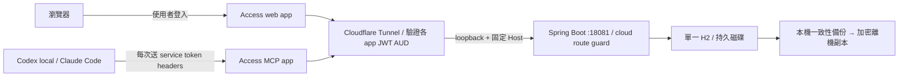

# 共用雲端看板部署方案

本文件與 `deploy/cloud/` 是待部署的 Linux VM 範本。程式與隔離測試可在本機驗證；
建立 VM、DNS、Tunnel、Access policy、上傳資料與正式切換前仍須取得使用者同意。
目前沒有已上線的雲端看板，也沒有完成真實 Cloudflare 與各裝置的端到端驗收。
官方資料查核日期：2026-11-08。

## 決策與選項

建議先用單台 Linux VM、JDK 21、單一 Spring Boot 實例與本機持久磁碟上的 H2。
基準容量為 2 GB RAM（JVM heap 768 MB）、至少 20 GB 持久磁碟；4 GB RAM 對升級與
備份更有餘裕。先量測真實 heap、資料庫與備份成長再調整。

| 決策 | 建議與取捨 |
|---|---|
| 雲端主機 | 優先使用已有帳號、熟悉且能提供可靠持久磁碟的供應商。DigitalOcean 等標準 VM 操作簡單；Hetzner 等低價 VM 可比較區域與延遲；Oracle 免費額度不列為可用性保證。未選供應商前不建資源。 |
| 資料庫 | 保留 H2，少改程式、容易備份；只能一個 JVM 開同一檔案，不適合共享磁碟或水平擴充。需要多實例、較嚴格可用性或大量寫入時，另案遷移 PostgreSQL 並重跑 CAS/Flyway 相容測試。 |
| 網路 | Cloudflare Named Tunnel，只有 outbound 連線；不用 VM 公網 HTTP 埠、不開放 18081。兩個 hostname 分離瀏覽器與機器授權。 |
| 瀏覽器 | `board.example.com` 的 whole-host Access application，Allow 限指定 email/IdP 群組，IdP 開 MFA。 |
| 機器 | `mcp.example.com` 的另一個 whole-host application，只有 Service Auth，逐裝置、最好逐客戶端 service token。 |
| 不支援自訂 header 的客戶端 | 不開 Bypass；另評估 Cloudflare Managed OAuth Beta 或正式 MCP OAuth gateway，需要額外實作及客戶端驗證。Anthropic 雲端 connector 不會繼承個人裝置的 WARP。 |

上線前需要決定：供應商與區域、每月預算、Cloudflare 管理的網域、允許登入者/IdP、
離機備份目的地與保存期限，以及要支援的確切客戶端與版本。

## 信任邊界



應用程式仍沒有逐 MCP 工具、逐專案或逐使用者的 server-side 授權。Access token
只識別某個機器憑證，不能證明是 leader、worker 或某位人員；獲准呼叫 MCP 的裝置
能呼叫所有工具。claim token 只保護任務生命週期，不是登入憑證。只把 MCP 存取權
發給可信任的操作者；worker 工具白名單依然是客戶端護欄。

應用只監聽 `127.0.0.1:18081`，VM 上的其他程序與管理員仍在信任邊界內。
cloud route guard 將 web Host 限於 GET/HEAD 並拒絕 MCP，MCP Host 僅接受 `/mcp`。
loopback Host 僅開放 live/ready 健康檢查。Host 路由限制本身不是驗證；認證依賴
Cloudflare Access 與 cloudflared 的 JWT 驗證。不得移除這兩層而公開 origin。

每條轉送至 origin 的 ingress 必須各自設定 `originRequest.access.required: true`、
正確 `teamName` 與該 app 專屬 `audTag`；不要只放在 YAML 頂層，不要共用 web/MCP AUD。
兩個 Access application 都涵蓋整個 hostname，避免依賴 path matching 作為認證邊界。
Cloudflare 文件指出 2026.10.0 的 ingress URL normalization 預設尚未開啟；應用另拒絕
含編碼、分號、反斜線、重複斜線或 dot segment 的模糊路徑。[官方 origin 設定](https://developers.cloudflare.com/cloudflare-one/networks/connectors/cloudflare-tunnel/configure-tunnels/origin-parameters/)

## 客戶端連線與憑證

MCP URL 是 `https://mcp.example.com/mcp`。Streamable HTTP 每次請求都要送
`CF-Access-Client-Id` 與 `CF-Access-Client-Secret`；service token 不是 OAuth access
token，也不是把 Secret 加上 `Bearer` 就能使用。

Codex 本機版的 `env_http_headers` 可從程序環境取出兩個 header：

```toml
[mcp_servers.board]
url = "https://mcp.example.com/mcp"
env_http_headers = { "CF-Access-Client-Id" = "BOARD_CF_CLIENT_ID", "CF-Access-Client-Secret" = "BOARD_CF_CLIENT_SECRET" }
```

Claude Code 使用 HTTP MCP 設定的 `headers` 與環境變數展開，範例只含變數名稱：

```json
{
  "mcpServers": {
    "board": {
      "type": "http",
      "url": "https://mcp.example.com/mcp",
      "headers": {
        "CF-Access-Client-Id": "${BOARD_CF_CLIENT_ID}",
        "CF-Access-Client-Secret": "${BOARD_CF_CLIENT_SECRET}"
      }
    }
  }
}
```

用 OS credential store/密碼管理器在啟動客戶端時注入環境，勿把值放到專案
`.mcp.json`、plugin manifest、命令列引數或 shell history。桌面 GUI 不一定繼承 shell
環境，必須實際測試它的啟動環境；不要把憑證交給對話中的 agent 讀取或列印。
安裝 plugin 後也要確保只有一個 `board` 設定生效，避免又接到舊 localhost URL。

以上是 Codex 本機與 Claude Code 的設定能力；不表示所有 Codex 雲端執行環境或
Claude Desktop/claude.ai 遠端 connector 都可用同樣方式。Claude custom connector
的自訂 headers 有組織方案、beta 與 header 核准限制，不能視為普遍支援。
確切官方文件與各客戶端能力見[雲端部署研究](cloud-research.md)；未驗證的客戶端不得
靠移除 Access 來排除連線問題。

若必須支援 Claude Chat/Cowork，Cloudflare Managed OAuth Beta 是可另行評估的
替代入口；需確認帳號功能、RFC 8707/discovery、redirect URI 與 origin assertion
驗證，不能把現有 Service Auth app 直接換成瀏覽器 Allow 即宣稱支援。
本次範本未實作或驗證 Managed OAuth。

Cloudflare Access MCP app 只設 Service Auth，明確選每個核准 service token，
不要使用 Allow/Everyone/Bypass，也不要用「Any service token」擴大存取範圍。
舊組織建議啟用 strict service token authentication（這是組織全域變更，先確認其他
應用影響）；2026-10-05 起建立的組織預設啟用。無論是否收到 cookie，每次仍送兩個
headers。[官方 service token 文件](https://developers.cloudflare.com/cloudflare-one/access-controls/service-credentials/service-tokens/)

憑證管理分成三類：VM 的 Tunnel credential JSON 只授予執行該 tunnel 的權限；
Cloudflare 管理 API token 不放 VM；每個裝置的 Access service token 只授權 MCP app。
JSON 與裝置 Secret 各自放在 repo 之外且限制讀取者。設定到期提醒，輪替時先測新值，
再撤銷舊值；遺失裝置立即撤銷該 token。不得啟用輸出 request headers/body 的 debug
logging、curl `-v`、`set -x`、會擷取 MCP claim token 的封包或對話記錄。
撤銷或登入到期後，既有長連線是否立即終止仍須實測；不要把新請求被拒絕當成
既有串流已關閉的證據。若發生憑證外洩，可先停止 tunnel 中斷現有連線，再撤銷與輪替。

## VM 安裝順序（尚未執行）

以下是**取得部署授權後只在雲端 VM 執行**的人工操作流程。不是本機安裝指令。
需要 root 管理權、systemd、JDK 21、bash、curl、lsof、unzip、cloudflared。

1. 建立專用無登入帳號 `ai-project-board` 與 `cloudflared-board`。建立
   `/etc/ai-project-board`、`/etc/cloudflared`，配置檔由 root 維護。
2. 建立 `/opt/ai-project-board/releases/<version>/`，放經 checksum 驗證的 Linux
   JAR，命名 `app.jar`；從相同版本複製 `bin/board-env.sh`、`bin/backup-db.sh`、
   `bin/restore-db.sh` 與 `deploy/cloud/preflight.sh`，保留相同目錄結構。release
   由 root 持有，應用帳號只能讀。將 `/opt/ai-project-board/current` 指向該 release。
3. 把 `deploy/cloud/board.env.example` 複製為 `/etc/ai-project-board/board.env`，
   修改兩個 hostname 及 `BOARD_ALLOWED_HOSTS`，權限 root:root 0600。
   保留完整 JDBC 字串，不加 shell 引號；這是 systemd EnvironmentFile。
4. 安裝 `ai-project-board.service` 至 `/etc/systemd/system/`。systemd 自動建立
   `/var/lib/ai-project-board` 與 `/var/log/ai-project-board`，preflight 建立 data
   子目錄並在 migration 前做冷備份。首次沒有資料庫會略過備份。
5. 先啟動 application，確認只有 `127.0.0.1:18081` listener；VM firewall 不開放
   80、443、18081、20001，只准必要管理入口及 Cloudflare 所需 outbound。
6. 在 Cloudflare 建立兩個 whole-host Access apps 與 policy，記下各自 AUD。
   然後建立 locally managed named tunnel，credential JSON 安裝成
   `/etc/cloudflared/board-tunnel.json`（root:cloudflared-board 0640；目錄 0750）。
   不要把具有全帳號管理能力的 `cert.pem` 複製到 VM。
7. 把 `cloudflared.yml.example` 複製為 `/etc/cloudflared/board.yml`，替換 UUID、
   team、兩個 hostname 與 AUD。使用相同版本的 cloudflared 執行下列離線設定檢查。
   尚未完成 Access 設定前不建立公開 DNS route、不啟動 tunnel。
8. 安裝 `cloudflared-board.service`，再建立兩個 hostname 的 Tunnel DNS route。
   啟動 tunnel 並跑完整驗收；不通過就停止 tunnel，origin 繼續只在 loopback。
9. 驗收通過後才 enable 兩個 service 開機啟動；最後把一台測試裝置切到遠端，
   成功後再逐台改設定。本機現有正式看板、資料與程序全程保留。

```bash
# Cloud VM only. These commands do not change DNS or create Cloudflare resources.
cloudflared tunnel --config /etc/cloudflared/board.yml ingress validate
cloudflared tunnel --config /etc/cloudflared/board.yml ingress rule https://mcp.example.com/mcp
cloudflared tunnel --config /etc/cloudflared/board.yml ingress rule https://mcp.example.com/api/projects
cloudflared tunnel --config /etc/cloudflared/board.yml ingress rule https://board.example.com/mcp
cloudflared tunnel --config /etc/cloudflared/board.yml ingress rule https://board.example.com/api/events
systemd-analyze verify /etc/systemd/system/ai-project-board.service /etc/systemd/system/cloudflared-board.service
```

預期依序命中 MCP origin、MCP 404、web MCP 404、web origin；其他 hostname
命中最後的 404。Native ingress 檢查不代表 Access policy 或 JWT 已通過實測。
[官方 ingress 驗證指令](https://developers.cloudflare.com/cloudflare-one/networks/connectors/cloudflare-tunnel/do-more-with-tunnels/local-management/configuration-file/)

## 資料、備份與還原

資料唯一權威來源為雲端 `/var/lib/ai-project-board/data/board.mv.db`，放持久磁碟，
不放容器 ephemeral layer、網路共享磁碟或 Git。不可同時啟動兩個 JVM，也不可對
執行中的 `.mv.db` 直接複製。首次可用空雲端資料庫；若要搬本機資料，必須另外批准
一次維護時間、正常停機產生一致性快照後匯入，不能暗中複製目前運作中的本機正式檔。

既有程式使用 H2 `BACKUP TO` 產生 scheduled/shutdown ZIP；preflight 在啟動 Flyway
前呼叫既有冷備份。範本每小時排程一次，每 phase 保留 30 天且至少 7 份。
這不保證固定磁碟上限：需監控資料與備份大小。正常 SIGTERM 等待最多 120 秒完成
shutdown snapshot；強制結束、斷電、磁碟滿都可能沒有該次備份。

同 VM 備份無法處理磁碟/主機/帳號整體遺失。上線必要條件是選定離機加密儲存：
建議物件儲存或另一個帳號，開版本/不可變保存，獨立持有解密金鑰與還原權。
離機程序只上傳已完成、非 `.tmp` 的 ZIP/冷備份，校驗 checksum，使用最小化 bucket
權限，每小時同步並監控最後成功時間。同步排程、儲存資源與金鑰需待選定目的地後
設定；目前範本**尚未提供或啟用離機備份 job**。

目標 RPO 可先定 2 小時（每小時快照加每小時離機同步，前提均成功），每月還原演練。
RTO 是建 VM、取回 release/config/備份並驗收所需時間，未演練前不承諾數字。
VM snapshot 只是補充，不能取代 H2 一致性快照與跨主機副本。

還原前先停 `cloudflared-board` 阻止新寫入，再停 `ai-project-board`。只在**雲端 VM**
以應用帳號執行，明確指定所有路徑，不使用裸的 `restore-db.sh latest`：

```bash
sudo -u ai-project-board env \
  BOARD_HOME_DIR=/var/lib/ai-project-board BOARD_PORT=18081 \
  BOARD_DB_URL='jdbc:h2:file:/var/lib/ai-project-board/data/board;DB_CLOSE_ON_EXIT=FALSE' \
  BOARD_LOG_FILE=/var/log/ai-project-board/board.log \
  BOARD_BACKUP_DIR=/var/lib/ai-project-board/backups \
  /bin/bash /opt/ai-project-board/current/bin/restore-db.sh \
  --db /var/lib/ai-project-board/data/board \
  --backup-dir /var/lib/ai-project-board/backups --list
```

檢查快照日期與 checksum 後，把最後一行 `--list` 換成選定快照的**完整絕對路徑**，
人工確認還原。腳本會保留被取代的 `.pre-restore-<UTC>`，不可立刻刪掉。先啟動
application，核對 ready、預期專案/任務/role 與 migration 版本；通過才啟動 tunnel。
若資料錯誤，再次停機選回保留快照。資料庫內容可能含專案機密，備份權限等同資料權限。

## 維運、更新與故障處理

只用 `systemctl start/stop/restart/status ai-project-board` 與
`systemctl start/stop/restart/status cloudflared-board` 管理雲端程序，systemd 追蹤確切
PID/cgroup。禁止 `pkill -f`、`killall` 或依 JAR 名稱清理。服務 on-failure 重啟有
速率上限，連續失敗須人工排查；這是單點系統，重啟期間會短暫不可用。

更新時先停 tunnel，再正常停止 app。確認 shutdown 與 migration 前備份存在並離機
保存，安裝新 immutable release 後改 `current` 指向，啟動 app，驗證成功才恢復 tunnel。
保留上一版 JAR、腳本與設定。Flyway 已遷移時不能只換回舊 JAR：需確認舊版相容，
否則停機還原升級前 DB，再指回舊 release；還原會失去升級後寫入，因此升級驗收期間
先維持 tunnel 關閉。不要同時讓新舊版本開同一 DB。

日常檢查使用 loopback `/api/health/live`、`/api/health/ready`、
`systemctl status`、`journalctl -u ai-project-board` 與 `/var/log/ai-project-board/`。
應用不記錄授權 header/body；不要啟用 HTTP debug。監控磁碟剩餘量、RAM/OOM、重啟次數、
最近備份與離機成功時間、Access token 到期及 Tunnel 連線。遠端 authenticated monitor
另建獨立 token，取得使用者授權後才設定告警或對外通知。

| 症狀 | 檢查與處理 |
|---|---|
| Cloudflare 502 / Tunnel offline | 先查 cloudflared unit、VM outbound、loopback ready；不開 origin 公網埠。 |
| 401/403 或客戶端收到登入 HTML | 查 Service Auth action、指定 token、兩個 headers 是否每次都有、期限與 strict auth；不可加 Bypass。 |
| cloudflared JWT 拒絕 | 確認 team 與該 hostname 專用 AUD，禁止移除 required。先停止發布再修設定。 |
| H2 鎖定 | 查確切 18081 listener 與資料檔使用者，找重複 systemd/manual JVM，不刪 lock 檔強闖。 |
| 啟動失敗 / migration error | 保留 log 與備份，停止重試風暴，按版本與 DB 配對回復。 |
| 空看板 | 先確認固定 JDBC 絕對路徑與掛載磁碟，不建立新資料覆蓋、不讀本機正式 DB。 |
| SSE 中斷或登入過期 | 完成 web 重新登入，確認 EventSource 重連與全量重抓。Access/Tunnel 不能保證永不中斷。 |
| 磁碟滿 | 先阻止新寫入、停止服務；確認離機副本可還原後，另經批准處理保存策略/擴容。 |

## 上線驗收 gate

### 隔離本機驗證

本次在 `/private/tmp/ai-board-cloud-validation` 的 detached worktree 執行
`./mvnw clean package`，所有 341 個測試通過；主工作區 `target/` 未參與建置。
最後調整 filter 順序後，另重跑 `CloudRouteGuardFilterTest` 並重新打包通過。
驗證環境明確指定非正式埠、獨立資料庫、日誌與備份目錄。

可使用標準函式庫 Python smoke runner 驗證已建置 JAR：

```bash
python3 scripts/cloud-check/smoke.py \
  --jar /private/tmp/ai-board-cloud-validation/target/ai-project-board-backend-3.2.1.jar
```

runner 自行選擇非 8080 埠、使用暫存 H2/日誌/備份、只終止自己啟動的確切子程序。
它涵蓋 Host/Origin 隔離、MCP 初始化/讀寫、競爭認領與相依阻擋、SSE 事件、重啟後
任務狀態保留。不要將它指向正式資料庫或把主工作區當作打包目錄。
2026-11-08 實際執行通過（exit 0），包含兩個獨立 MCP session 競爭、三種變更事件與
相同 H2 檔案重啟比對。另刻意注入衝突的 SERVER_PORT/SERVER_ADDRESS 環境設定，
確認 runner 的 CLI 設定仍強制隨機非 8080 埠與 loopback；測試未輸出回應或 claim token。
部署 shell 語法與九組錯誤環境設定拒絕檢查已通過；此處沒有執行真正 systemd、
cloudflared、Access、遠端客戶端或離機備份驗證。

### 真實雲端驗收

在雲端全新測試資料庫先完成下列項目並記錄結果、版本與時間，禁止直接拿本機正式
資料做測試。可用隔離 E2E smoke script 驗證應用；它不能替代以下真 Cloudflare gate。

1. 匿名瀏覽 web 要求登入，只有核准使用者能讀 UI/REST/SSE；未授權使用者被擋。
2. 匿名、錯誤、到期與已撤銷 token 無法讀寫 MCP；不能從 web Host 呼叫 `/mcp`，
   MCP Host 不能讀 `/api/projects`。兩 app 的憑證不能互相越界。
3. 在暫存驗收 hostname 故意不配 Access app、仍保留 origin JWT required，確認
   cloudflared 拒絕，證明 Access 漏配時 fail closed；不能停用正式 Access 做實驗。
   strict service auth 與 cloudflared JWT 的組合也必須以真 token 實測，失敗即停止發布。
4. 每種要用的 Codex/Claude 客戶端從兩台裝置完成 initialize、tools/list、建立驗收
   專案/任務、list、併發認領、更新與完成；同一任務只給一個 worker，未完成前置不得發放。
   不把 claim token 輸出到驗收報告、檔案或 log。驗收資料是否刪除另取同意。
5. 登入的瀏覽器開啟 `/api/events`，另一台裝置經 MCP 改任務，畫面即時更新。
   中斷網路、重啟 tunnel、重啟 app、使 Access session 過期後重新登入，確認重連後
   與 REST 全量資料一致；不要求 SSE event replay，現有前端靠重新抓取復原。
6. 記下已建立專案與任務 ID，正常重啟 app 與整台 VM 後再查同一資料、role 與狀態。
   驗證 shutdown/scheduled/startup 備份與離機 checksum，另用隔離 VM 還原並重跑讀寫。
7. 關閉原本個人電腦，用另一裝置確認看板仍能工作；最後核對 cloud origin 無公網 listener。

## 成本與已知限制

查核時 [DigitalOcean Basic Regular](https://www.digitalocean.com/pricing/droplets)
2 GiB 為 **US$12/月**、4 GiB 為 **US$24/月**；
[Lightsail Linux IPv4](https://aws.amazon.com/lightsail/pricing/) 2 GB 為 **US$12/月**。
另計網域年費、離機備份、稅、超額流量；供應商與區域確定後再確認結帳價格。
可比較 [Hetzner Cloud](https://www.hetzner.com/cloud/) 的區域與容量。
Cloudflare 有 Free 方案，但不能把舊指南的 50 人、24 小時日誌直接當成本帳號目前
可用功能或 SLA。現行方案、seat、service token 數量、日誌與 beta 功能需分別確認，
詳見[研究文件的價格與 account limits 查核](cloud-research.md#成本與供應商選項)及
[Cloudflare 官方方案](https://www.cloudflare.com/plans/zero-trust-services/)。

單 VM/H2 沒有 HA、橫向擴充與逐工具 RBAC；Cloudflare/IdP 失效會影響遠端入口。
應用只驗 Host/路徑，無本地 JWT 驗證及 caller audit；cloudflared 必須持續驗證 JWT。
使用者身分/機器授權記錄位於 Access，不等同任務 log 的 assignee。SSE 有預設 32
連線限制，長連線會重連；不要未量測就提高上限。cloudflared/systemd 真部署、
Access policy、離機同步、客戶端 header 注入及復原時間，皆須於選定資源後實機驗收。
